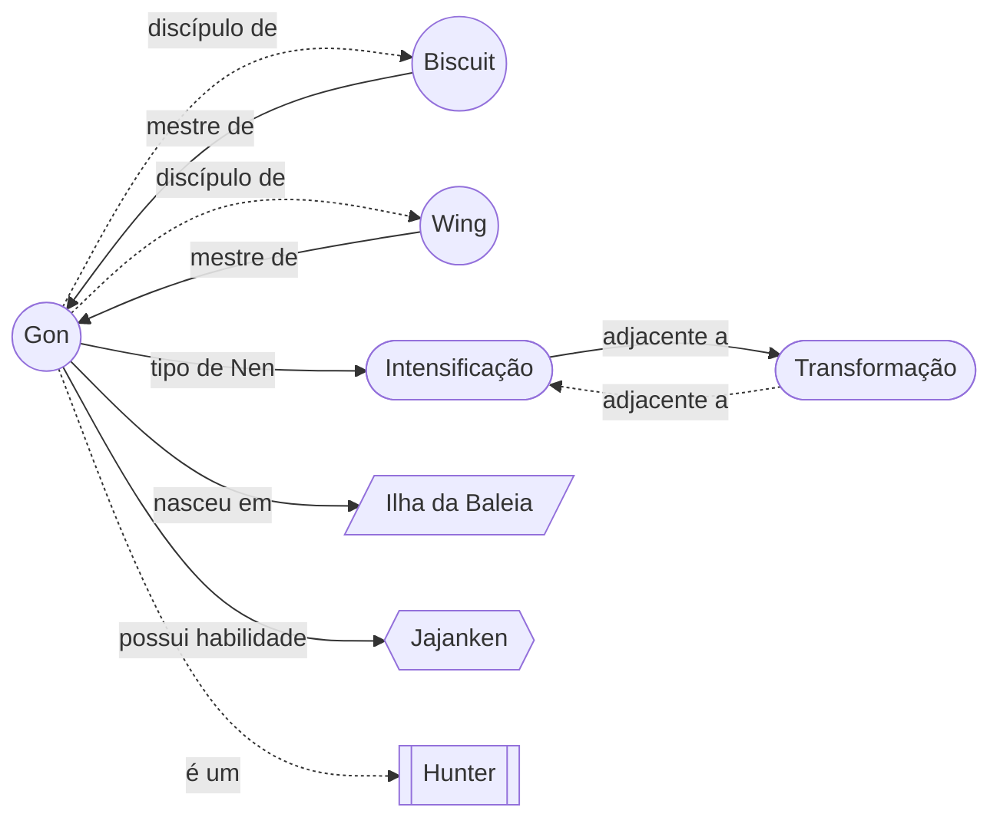
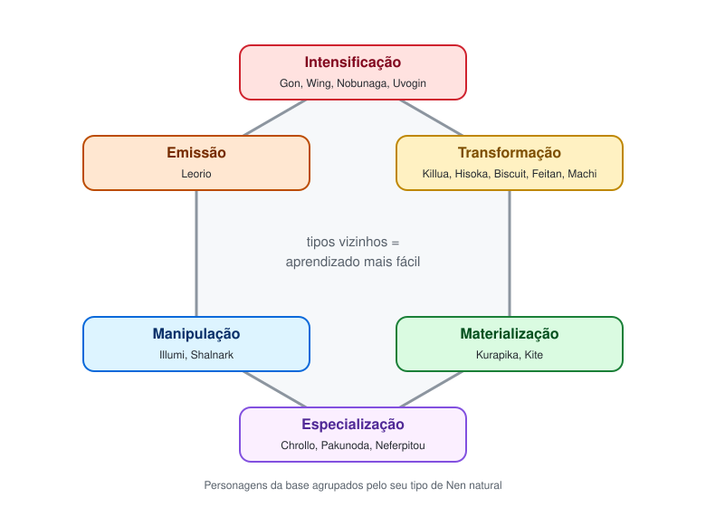
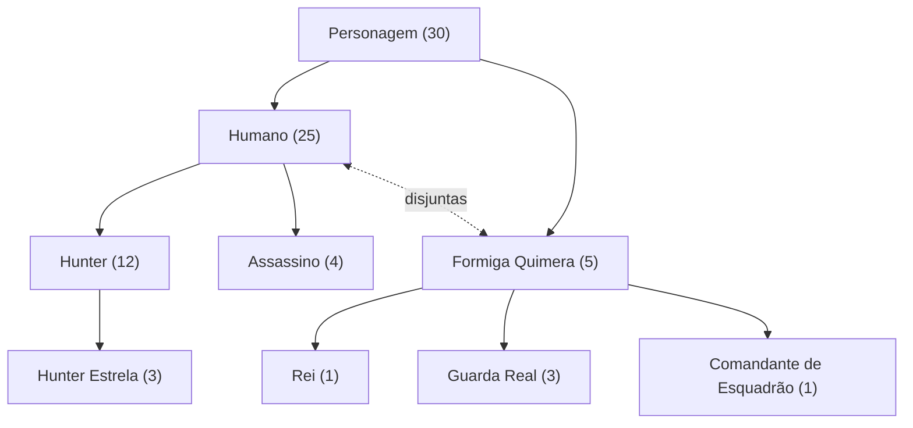
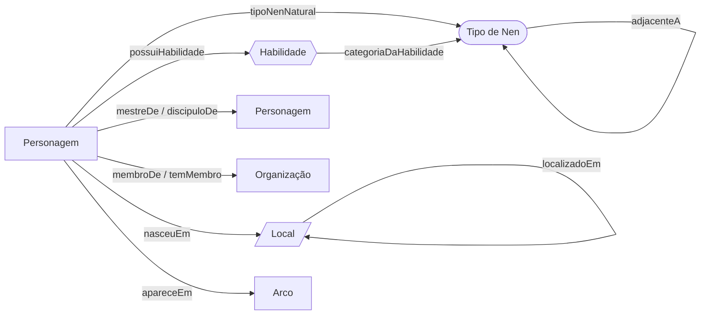
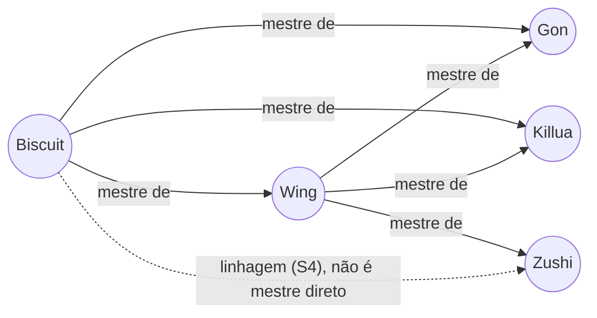
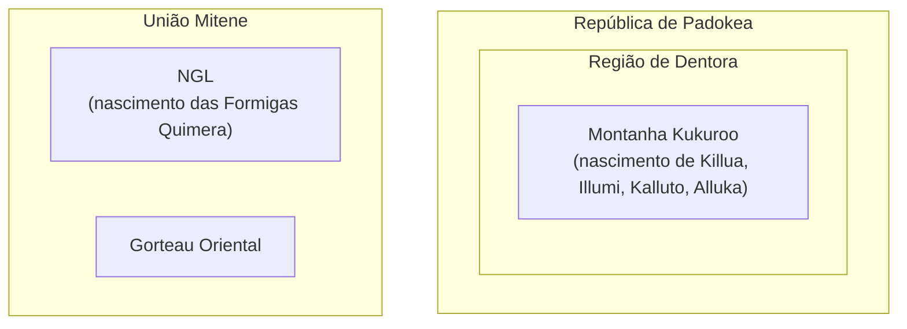
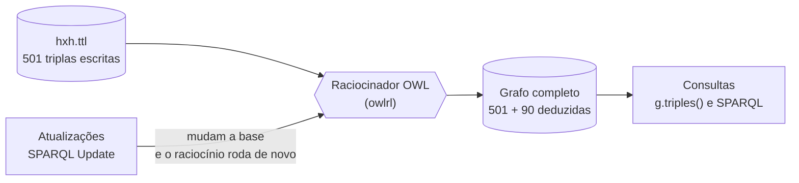
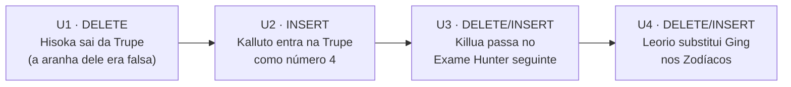

# O universo de Hunter x Hunter como base de conhecimento

## Informações do aluno

**Aluno:** Diego de Carvalho Dias  
**Matrícula:** 20230089696

## 1. A ideia

Este projeto transforma o universo do anime **Hunter x Hunter** em uma **base de conhecimento** que o computador consegue consultar e sobre a qual consegue **raciocinar**.

A base guarda personagens, organizações, o sistema de poderes (Nen), habilidades, locais e arcos da história. Ela é escrita em **RDF/RDFS/OWL**, no formato **Turtle** ([`hxh.ttl`](hxh.ttl)), e consultada em Python com **rdflib** e **SPARQL** ([`consultas.py`](consultas.py)).

O ponto central: a base não é só uma lista de fatos. Ela também tem **regras sobre o mundo**. Por exemplo, ninguém precisou escrever que "Gon é Hunter". A base sabe que **Hunter é todo humano com licença**, sabe que o Gon tem licença, e conclui o resto sozinha.

## 2. Como um computador "sabe" coisas: triplas

Em RDF, todo conhecimento é escrito como frases de três partes, as **triplas**:

> **sujeito** → **predicado** → **objeto**

Por exemplo, "Biscuit é mestre do Gon" vira `hxh:Biscuit hxh:mestreDe hxh:Gon`. Juntando muitas triplas, temos um **grafo**: os círculos são as coisas e as setas são as relações.

Abaixo, um pedaço do grafo em volta do Gon. As setas **contínuas** estão escritas no arquivo `.ttl`. As **tracejadas** ninguém escreveu: foram **deduzidas** pelo raciocinador.



## 3. Um pouco de Hunter x Hunter

Só o necessário para entender a base:

- **Hunters** são pessoas que passaram no difícil **Exame Hunter** e receberam uma **licença**. Os melhores ganham **estrelas** (uma, duas ou três) por grandes feitos.
- **Nen** é o sistema de poderes. Todo usuário nasce com **um** dos **seis tipos** de Nen. Os tipos formam um **hexágono**: quanto mais perto do seu tipo, mais fácil aprender. Por isso o Gon (Intensificação) aprende bem Transformação e Emissão, que são vizinhas, e tem dificuldade com Especialização, do lado oposto.
- Cada usuário cria **habilidades** próprias, como o Jajanken do Gon ou o Godspeed do Killua.
- Há **organizações** importantes: a Associação Hunter, os Doze Zodíacos, a Trupe Fantasma (ladrões com aranhas numeradas tatuadas), a Família Zoldyck (assassinos) e o Reino das Formigas Quimera.



## 4. A base em números

| Requisito | Mínimo pedido | Nesta base |
| --- | --- | --- |
| Classes em hierarquia | 8, com 2+ níveis abaixo da raiz | **14**, com até **3 níveis** abaixo da raiz |
| Propriedades | 10 (5 de objeto + 5 de dados) | **17** (11 de objeto + 6 de dados) |
| Indivíduos | 25 | **68** |
| Triplas no `.ttl` | 50 | **501** (+90 deduzidas pelo raciocinador) |
| Construções OWL | 5 | **8 tipos diferentes** |

Todos os fatos vêm do anime de 2011 e da lista de personagens da Wikipedia. O que a obra **nunca revelou**, como o tipo de Nen do Ging ou do Rei Meruem, **ficou de fora de propósito**. Uma base de conhecimento só deve afirmar o que se sabe.

## 5. A taxonomia (hierarquia de classes)

A hierarquia responde à pergunta "o que é o quê". Cada seta significa **"é um tipo de"** (`rdfs:subClassOf`). O número entre parênteses é quantos indivíduos pertencem à classe **depois do raciocínio**.



Como ler:

- **Personagem** é a raiz. Todo personagem é **Humano** ou **Formiga Quimera**, e nunca os dois: as classes são **disjuntas**.
- **Hunter** é um tipo de Humano, e **Hunter Estrela** é um tipo de Hunter. É o ramo mais fundo: Personagem → Humano → Hunter → Hunter Estrela.
- **Assassino** também é um tipo de Humano. Uma pessoa pode ser Hunter e Assassino ao mesmo tempo, como o Illumi.
- As Formigas Quimera se dividem pela posição na hierarquia do formigueiro: o **Rei**, os três **Guardas Reais** e os **Comandantes de Esquadrão**.

Além dessa árvore, há cinco classes independentes que descrevem o mundo: **Tipo de Nen (6)**, **Habilidade (10)**, **Organização (5)**, **Local (10)** e **Arco (7)**.

## 6. As relações (propriedades)

### Como as classes se conectam

Cada seta é uma **propriedade de objeto**: liga uma coisa a outra coisa. O começo da seta é o **domínio** (`rdfs:domain`) e a ponta é a **imagem** (`rdfs:range`).



### Os valores (propriedades de dados)

As **propriedades de dados** ligam uma coisa a um valor simples, como um número ou verdadeiro/falso.

| Propriedade | Vale para | Tipo | Exemplo |
| --- | --- | --- | --- |
| `possuiLicenca` | Humano | verdadeiro/falso | Gon → `true` |
| `numeroDeEstrelas` | Hunter Estrela | inteiro | Cheadle → `3` |
| `numeroNaTrupe` | Personagem | inteiro | Chrollo → `0` (líder) |
| `idade` | Personagem | inteiro | Biscuit → `57` |
| `episodioInicial` | Arco | inteiro | Formigas Quimera → `76` |
| `episodioFinal` | Arco | inteiro | Formigas Quimera → `136` |

## 7. As construções OWL e por que cada uma existe

O RDFS descreve **o que existe**. O OWL acrescenta **regras** que o raciocinador usa para deduzir fatos novos ou detectar erros. Cada regra abaixo vem de algo verdadeiro no anime, e cada uma tem um efeito visível na saída do programa.

| Construção OWL | Onde | Por que, no anime | Efeito visível |
| --- | --- | --- | --- |
| `owl:inverseOf` | `mestreDe` ↔ `discipuloDe` | Se Biscuit é mestre do Gon, o Gon é discípulo dela. | **T1**: "Gon discípulo de Biscuit" aparece sem ter sido escrito |
| `owl:inverseOf` | `membroDe` ↔ `temMembro` | Se Machi é membro da Trupe, a Trupe tem Machi como membro. | **S3** lista a Trupe usando `temMembro`, que não existe no arquivo |
| `owl:SymmetricProperty` | `adjacenteA` | No hexágono, ser vizinho é mútuo. Só metade das arestas foi escrita. | **S1**: Biscuit aparece como vizinha do Gon (Transformação ↔ Intensificação) |
| `owl:TransitiveProperty` | `localizadoEm` | Montanha Kukuroo fica em Dentora, que fica em Padokea. Logo, Kukuroo fica em Padokea. | **T6** e **S5**: os Zoldyck aparecem como nascidos em Padokea |
| `owl:FunctionalProperty` | `tipoNenNatural`, `nasceuEm`, `possuiLicenca` e mais 5 | Cada pessoa nasce com **um** tipo de Nen; tem ou não tem licença, nunca os dois. | **U3**: a licença do Killua precisa ser **trocada** (DELETE/INSERT), não só acrescentada |
| `owl:IrreflexiveProperty` | `mestreDe` | Ninguém é mestre de si mesmo. | Protege a base contra esse erro |
| `owl:disjointWith` | Humano × Formiga Quimera, e entre as classes de topo | Uma formiga quimera não é humana, mesmo com aparência humana. | **B1**: o raciocinador acusa a contradição quando dizemos que Meruem é humano |
| `owl:oneOf` | `TipoDeNen` | Existem **exatamente** seis tipos de Nen. A lista é fechada. | Garante que não surja um "sétimo tipo" |
| `owl:equivalentClass` + `owl:hasValue` | `Hunter` | **Ser Hunter é ter licença.** Hunter é definido, não só declarado. | **T5**: 12 Hunters deduzidos sem nenhum declarado; **U3**: Killua vira Hunter ao ganhar a licença |

### Uma escolha de propósito: `mestreDe` **não** é transitiva

Biscuit ensinou Wing, e Wing ensinou Zushi. Mas **Biscuit nunca treinou Zushi**. Se `mestreDe` fosse transitiva, a base concluiria algo falso. Para ver a "linhagem" completa, a consulta **S4** usa um caminho do SPARQL (`mestreDe+`), que segue a corrente sem afirmar nada falso na base.



### Os locais e a transitividade



O arquivo só diz que Kukuroo fica **dentro de** Dentora e que Dentora fica **dentro de** Padokea. O raciocinador conclui que Kukuroo fica em Padokea.

## 8. Como o programa funciona



1. O programa lê o `hxh.ttl`.
2. O **raciocinador** ([owlrl](https://github.com/RDFLib/OWL-RL)) aplica as regras OWL e acrescenta **90 fatos deduzidos**. O owlrl também gera centenas de triplas genéricas sobre a própria linguagem OWL, que não interessam aqui; o programa guarda só as deduções sobre o universo de Hunter x Hunter.
3. As consultas rodam sobre o grafo completo, com fatos escritos e deduzidos.
4. As atualizações alteram a base **em memória** (o arquivo `.ttl` nunca muda). Depois de cada uma, o raciocinador roda de novo, e o programa mostra o **antes e depois**.

## 9. As consultas

Cada consulta aparece na saída com um código (T1, S1, U1...) e o seu propósito. No código, cada uma tem um comentário explicando o que busca e o resultado esperado.

### Parte 1: `g.triples()`

O `g.triples((s, p, o))` busca triplas por padrão. O que for `None` funciona como "qualquer coisa".

| # | Padrão | Pergunta | Resultado |
| --- | --- | --- | --- |
| T1 | `(Gon, None, None)` | O que a base sabe sobre o Gon? | 18 fatos, 4 deles deduzidos (é Hunter, é Personagem, discípulo de Wing e Biscuit...) |
| T2 | `(None, mestreDe, None)` | Quem ensinou quem? | 8 pares mestre → discípulo |
| T3 | `(None, None, Intensificação)` | O que se liga à Intensificação? | 4 usuários, 2 habilidades e os 2 tipos vizinhos |
| T4 | `(Kurapika, possuiHabilidade, None)` | Quais as habilidades do Kurapika? | Chain Jail e Emperor Time |
| T5 | `(None, rdf:type, Hunter)` | Quem é Hunter? | 12 Hunters, **todos deduzidos**. Killua não aparece: ainda não tem licença |
| T6 | `(Kukuroo, None, Padokea)` | Como Kukuroo se liga a Padokea? | "localizado em", **deduzido** por transitividade |

### Parte 2: SPARQL

| # | Tipo | Pergunta | Resultado |
| --- | --- | --- | --- |
| S1 | SELECT + **FILTER** | Quem tem tipo de Nen igual ou vizinho ao do Gon? | 3 do mesmo tipo e 6 de tipos vizinhos |
| S2 | SELECT + **agregação** | Quantos usuários conhecidos tem cada tipo? | Transformação lidera com 5; Emissão tem só o Leorio |
| S3 | SELECT + **ORDER BY** | Quem é da Trupe Fantasma, em ordem de número? | Chrollo (0), Nobunaga (1), ..., Uvogin (11) |
| S4 | SELECT + **caminho** `+` | Quem está na linhagem de discípulos da Biscuit? | Wing, Gon e Killua diretos; Zushi indireto |
| S5 | SELECT + transitividade | Quem nasceu em algum lugar de Padokea? | Os quatro Zoldyck da base |
| S6 | SELECT + cálculo + agregação | Quais os arcos mais longos e quantos personagens da base aparecem em cada? | Formigas Quimera: 61 episódios, 11 personagens |
| A1 | **ASK** | Os tipos de Gon e Killua são vizinhos no hexágono? | `True` |
| A2 | **ASK** | Algum membro da Trupe Fantasma é Hunter? | `True` (Hisoka) |
| C1 | **CONSTRUCT** | Quais tipos cada protagonista aprende com facilidade? | Um grafo **novo** com 12 triplas `aprendeComFacilidade` |

### Parte 2: atualizações (a história avança)

As atualizações seguem acontecimentos reais do anime, em ordem:



| # | Atualização | Antes | Depois |
| --- | --- | --- | --- |
| U1 | `DELETE DATA`: Hisoka deixa a Trupe | "Algum membro da Trupe é Hunter?" → `True` | → `False` (Hisoka era o único) |
| U2 | `INSERT DATA`: Kalluto assume o número 4 | Trupe sem o número 4 | Kalluto aparece como número 4 |
| U3 | `DELETE/INSERT`: licença do Killua `false` → `true` | "Killua é Hunter?" → `False` | → `True`, **deduzido** pela definição de Hunter |
| U4 | `DELETE/INSERT`: Ging sai dos Zodíacos e Leorio entra | Cheadle, Ging, Pariston | Cheadle, Leorio, Pariston |

A **U3** mostra RDF, OWL e SPARQL trabalhando juntos: a atualização só troca um valor, e o raciocinador conclui sozinho que o Killua agora é Hunter.

### Bônus: o raciocinador recusa contradições

| # | O que acontece |
| --- | --- |
| B1 | Inserimos por engano que o Rei Meruem é humano. O raciocinador acusa: *"Disjoint classes FormigaQuimera and Humano have a common individual Meruem"*. É o `owl:disjointWith` funcionando como verificação de qualidade da base. |

## 10. Como executar

Pré-requisito: **Python 3.10 ou mais recente**.

```bash
# 1. Entre na pasta do projeto
cd mini-projeto-3

# 2. Crie e ative um ambiente virtual
python3 -m venv .venv
source .venv/bin/activate        # no Windows: .venv\Scripts\activate

# 3. Instale as dependências (rdflib e owlrl)
pip install -r requirements.txt

# 4. Rode todas as consultas
python consultas.py
```

A saída começa com as estatísticas da base e segue com as partes 1, 2 e o bônus, nessa ordem. A execução leva cerca de 1 segundo.

## 11. Arquivos

| Arquivo | Conteúdo |
| --- | --- |
| [`hxh.ttl`](hxh.ttl) | A base de conhecimento: classes, propriedades, regras OWL e indivíduos, com comentários |
| [`consultas.py`](consultas.py) | Carrega a base, roda o raciocinador e executa todas as consultas |
| [`requirements.txt`](requirements.txt) | Dependências com versões fixas |
| [`img/hexagono-nen.svg`](img/hexagono-nen.svg) | Figura do hexágono de Nen |

## Fontes

- [Lista de personagens de Hunter × Hunter (Wikipedia)](https://en.wikipedia.org/wiki/List_of_Hunter_%C3%97_Hunter_characters): tipos de Nen, números da Trupe Fantasma, estrelas, mestres e discípulos.
- [Lista de episódios do anime de 2011 (Wikipedia)](https://en.wikipedia.org/wiki/List_of_Hunter_%C3%97_Hunter_(2011_TV_series)_episodes): episódios de cada arco.
